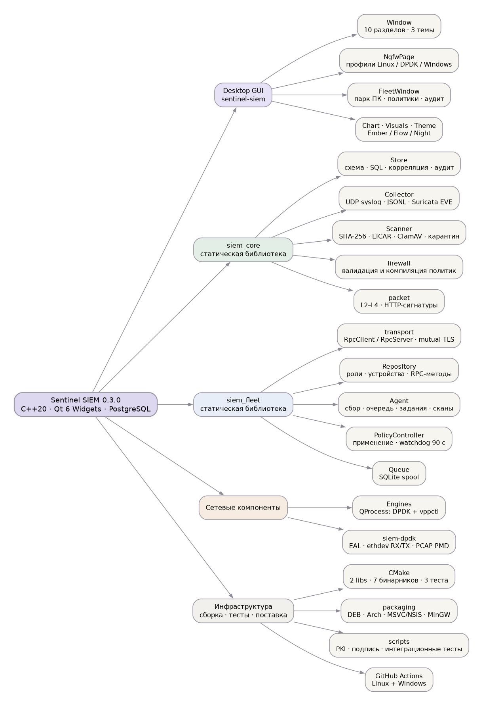

# Карта проекта Sentinel SIEM

**Срез:** рабочая копия `/home/ilya/Siem-desktop`, ветка `main`, коммит `8c22fde` (31.10.2026), 03.11.2026.
**Версия:** 0.3.0 · C++20 · Qt 6 Widgets · CMake/Ninja · PostgreSQL.
**Назначение:** нативная desktop-консоль SIEM для лабораторной эксплуатации: сбор и поиск событий, корреляция, инциденты, антивирус и карантин, NGFW-политики, DPDK-сенсор, телеметрия VPP. В 0.3 добавлен управляемый парк ПК: `siem-server`, `siem-agent` и отдельный режим консоли `FleetWindow`.



---

## 1. Режимы работы

| Режим | Запуск | Хранилище | Назначение |
|---|---|---|---|
| Демо | `sentinel-siem --demo` | временная SQLite, удаляется при выходе | показ всех разделов без PostgreSQL; применение firewall к ОС отключено |
| Локальная консоль | `sentinel-siem` или `--connect-env` | PostgreSQL через QPSQL | рабочее место одного аналитика на одном ПК |
| Консоль парка | `sentinel-siem --fleet console.json` | PostgreSQL на `siem-server` | управление компьютерами, политиками, заданиями; пароля БД на клиенте нет |
| Сервер | `siem-server --config server.json` | PostgreSQL | mTLS JSON-RPC, роли, выдача политик, приём событий, retention |
| Агент | `siem-agent --config agent.json` | локальный SQLite-spool | фоновая служба Windows/Linux: журналы, syslog, сканы, firewall |
| CLI-клиент | `siem-fleetctl --config console.json <method>` | — | разовые RPC-запросы и диагностика |
| Сенсор | `siem-dpdk --pcap …` / `--inline` | stdout JSONL | DPDK-анализ и inline-фильтрация на шлюзе |

Локальный GUI не требует root. Привилегированные операции вынесены в `siem-firewall-helper`, который запускается через polkit/UAC. DPDK/VPP — отдельные Linux-компоненты; на Windows локального dataplane нет.

---

## 2. Структура репозитория

```text
Siem-desktop/
├── CMakeLists.txt              # 2 статические библиотеки, 7 бинарников, 3 тестовых
├── README.md                   # эксплуатация, сборка, границы возможностей
├── assets/                     # style.qss, night.qss, SVG-иконки, assets.qrc
├── src/
│   ├── main.cpp                # точка входа GUI
│   ├── server_main.cpp         # siem-server
│   ├── agent_main.cpp          # siem-agent
│   ├── fleetctl_main.cpp       # siem-fleetctl
│   ├── update_verify_main.cpp  # siem-update-verify
│   ├── firewall_helper.cpp     # siem-firewall-helper
│   ├── core/                   # Store, Collector, Scanner, firewall
│   ├── fleet/                  # транспорт, репозиторий, агент, политики, очередь
│   ├── network/                # packet, Engines, DPDK-сенсор
│   └── ui/                     # Window, NgfwPage, FleetWindow, графика, темы
├── tests/                      # core_tests, fleet_tests, ui_tests (QtTest)
├── scripts/                    # PKI, подпись, пакеты, интеграционные проверки
├── packaging/
│   ├── fleet/                  # примеры server/agent/console JSON
│   ├── linux/                  # Dockerfile, PKGBUILD, systemd units, .desktop
│   └── windows/                # build.ps1, NSIS, cross-build, установка службы
├── docs/                       # архитектура, Fleet, NGFW, лаборатория, валидация
├── samples/                    # events.jsonl, http-lab.pcap, vpp-lab.conf, eicar/
├── .github/workflows/build.yml # secrets + Ubuntu + Windows CI
├── .githooks/                  # pre-commit / pre-push (проверка секретов)
├── build/                      # локальная сборка (игнорируется)
├── dist/                       # пакеты (игнорируется)
└── .dev/                       # локальный PostgreSQL, PKI, VPP (игнорируется)
```

Всего в `src/` и `tests/` около **8,8 тыс. строк** C++: UI — 3,7 тыс., fleet — 1,7 тыс., core — 1,3 тыс., network — 0,6 тыс., точки входа — 0,8 тыс., тесты — 0,6 тыс.

---

## 3. Цели сборки

| Цель | Тип | Исходники | Роль |
|---|---|---|---|
| `siem_core` | STATIC | [store.cpp](../src/core/store.cpp), [collector.cpp](../src/core/collector.cpp), [scanner.cpp](../src/core/scanner.cpp), [firewall.cpp](../src/core/firewall.cpp), [packet.cpp](../src/network/packet.cpp), [engines.cpp](../src/network/engines.cpp) | общая модель данных и движки |
| `siem_fleet` | STATIC | [common.cpp](../src/fleet/common.cpp), [transport.cpp](../src/fleet/transport.cpp), [queue.cpp](../src/fleet/queue.cpp), [repository.cpp](../src/fleet/repository.cpp), [service.cpp](../src/fleet/service.cpp), [policy.cpp](../src/fleet/policy.cpp), [agent.cpp](../src/fleet/agent.cpp) | управляемый парк |
| `sentinel-siem` | GUI (`WIN32`) | [main.cpp](../src/main.cpp), [window.cpp](../src/ui/window.cpp), [chart.cpp](../src/ui/chart.cpp), [visuals.cpp](../src/ui/visuals.cpp), [theme.cpp](../src/ui/theme.cpp), [ngfw_page.cpp](../src/ui/ngfw_page.cpp), [fleet_window.cpp](../src/ui/fleet_window.cpp), [assets.qrc](../assets/assets.qrc) | desktop-консоль |
| `siem-server` | exe | [server_main.cpp](../src/server_main.cpp) | RPC-сервер парка |
| `siem-agent` | exe | [agent_main.cpp](../src/agent_main.cpp) | фоновая служба ПК |
| `siem-fleetctl` | exe | [fleetctl_main.cpp](../src/fleetctl_main.cpp) | CLI к серверу |
| `siem-update-verify` | exe | [update_verify_main.cpp](../src/update_verify_main.cpp) | проверка подписи релиза |
| `siem-firewall-helper` | exe | [firewall_helper.cpp](../src/firewall_helper.cpp) | привилегированное применение правил |
| `siem-dpdk` | exe, Linux + DPDK | [dpdk_sensor.cpp](../src/network/dpdk_sensor.cpp), [packet.cpp](../src/network/packet.cpp), [firewall.cpp](../src/core/firewall.cpp) | пакетный сенсор |
| `siem-tests` | тест | [core_tests.cpp](../tests/core_tests.cpp) | CTest `core` |
| `siem-fleet-tests` | тест | [fleet_tests.cpp](../tests/fleet_tests.cpp) | CTest `fleet` |
| `siem-ui-tests` | тест | [ui_tests.cpp](../tests/ui_tests.cpp) + [ngfw_page.cpp](../src/ui/ngfw_page.cpp), [theme.cpp](../src/ui/theme.cpp), [assets.qrc](../assets/assets.qrc) | CTest `ui-profiles` |

Опции CMake: `SIEM_WITH_DPDK=ON` (по умолчанию; при отсутствии libdpdk сенсор пропускается с предупреждением), `SIEM_BUILD_TESTS=ON`. Установка — GNUInstallDirs; на Linux дополнительно ставятся desktop-файлы, systemd-юниты и иконка, на Windows — `qt_generate_deploy_app_script` и DLL PostgreSQL при заданном `SIEM_PG_RUNTIME_DIR`.

---

## 4. Слой `core`

| Файл | Строк | Что делает |
|---|---:|---|
| [store.cpp](../src/core/store.cpp) / [store.h](../src/core/store.h) | 365 / 51 | подключение QPSQL или QSQLITE, создание схемы, prepared statements, транзакционный `ingest`, корреляция правил, инциденты, retention, аудит, CAS-обновление `meta`, демо-данные, JSON-экспорт |
| [collector.cpp](../src/core/collector.cpp) / [collector.h](../src/core/collector.h) | 114 / 28 | UDP syslog на loopback, разбор RFC5424, обычных строк, JSONL и Suricata EVE, импорт файла |
| [scanner.cpp](../src/core/scanner.cpp) / [scanner.h](../src/core/scanner.h) | 240 / 41 | фоновое сканирование в `QtConcurrent`: SHA-256, EICAR, `clamscan` с тайм-аутом, отмена, карантин и восстановление с проверкой хеша |
| [firewall.cpp](../src/core/firewall.cpp) / [firewall.h](../src/core/firewall.h) | 471 / 19 | нормализация и валидация политик, компиляция nftables batch, проверки DPDK/Windows, разбор портов и сводки |
| [packet.cpp](../src/network/packet.cpp) / [packet.h](../src/network/packet.h) | 225 / 18 | Ethernet, VLAN, IPv4/IPv6, TCP/UDP, ARP; HTTP-сигнатуры SQLi/XSS/path traversal; решение `packetBlocked` |
| [engines.cpp](../src/network/engines.cpp) / [engines.h](../src/network/engines.h) | 298 / 58 | автоподключение VPP, разбор `show hardware-interfaces`, поиск свободных портов на `vfio-pci`, запуск `siem-dpdk` через `QProcess`, разбор JSONL, PCAP-проба при занятом порте |

Ключевые инварианты: время в UTC ISO8601; все значения — через bind-параметры; событие, актив, метки корреляции и инцидент пишутся одной транзакцией; для PostgreSQL `id INTEGER PRIMARY KEY` переписывается в `BIGSERIAL`; SQLite используется только для демо/тестов и как spool агента, но не как fallback PostgreSQL.

---

## 5. Слой `fleet`

| Файл | Строк | Что делает |
|---|---:|---|
| [common.cpp](../src/fleet/common.cpp) / [common.h](../src/fleet/common.h) | 146 / 23 | лимит кадра 1 МиБ, batch 50, TLS-конфигурация (CA, сертификат, ключ, проверка peer), SHA-256 отпечаток сертификата, чтение приватных файлов, `databaseConfig`, политика endpoint по умолчанию |
| [transport.cpp](../src/fleet/transport.cpp) / [transport.h](../src/fleet/transport.h) | 141 / 39 | `RpcClient` — одно TLS-соединение на запрос, JSON + `\n`, тайм-аут, ограничение ответа; `RpcServer` — mutual TLS, один обработчик на соединение |
| [queue.cpp](../src/fleet/queue.cpp) / [queue.h](../src/fleet/queue.h) | 102 / 27 | долговечный SQLite-spool: `queue`, `state`, `queue_stats`; лимиты по числу событий и объёму, batch/ack, backpressure |
| [repository.cpp](../src/fleet/repository.cpp) / [repository.h](../src/fleet/repository.h) | 347 / 18 | серверная логика: `fleet_*` таблицы, роли admin/analyst, регистрация по одноразовому коду, дедупликация доставки, выдача политик и команд, аудит |
| [service.cpp](../src/fleet/service.cpp) / [service.h](../src/fleet/service.h) | 82 / 8 | интеграция с Windows SCM (`--service`), обработка SIGINT/SIGTERM, единая обёртка `runService` |
| [policy.cpp](../src/fleet/policy.cpp) / [policy.h](../src/fleet/policy.h) | 238 / 33 | применение endpoint-политики через helper, состояние на диске, отдельный watchdog-процесс с дедлайном 90 с, откат при остановке/рестарте |
| [agent.cpp](../src/fleet/agent.cpp) / [agent.h](../src/fleet/agent.h) | 424 / 43 | журналы journald/Windows Event Log, UDP syslog, очередь, health, регистрация, poll-цикл, команды сканирования, расписание антивируса |

Схема взаимодействия: агент отправляет `agent.poll` с батчем событий, health и результатами команд; сервер отвечает `ack`, актуальной политикой, списком команд и токеном подтверждения. Политика считается подтверждённой, только когда health агента содержит тот же `policy_token`. Идентичность обеих сторон — SHA-256 сертификата (64 hex-символа); оператор и устройство не могут использовать один сертификат.

---

## 6. Слой `ui`

| Файл | Строк | Что делает |
|---|---:|---|
| [window.cpp](../src/ui/window.cpp) / [window.h](../src/ui/window.h) | 1720 / 102 | оболочка GUI, навигация, 10 страниц, таблицы, фильтры, импорт/экспорт, отчёты, темы, smoke-тест, владение `Collector`/`Scanner`/`Engines` |
| [ngfw_page.cpp](../src/ui/ngfw_page.cpp) / [ngfw_page.h](../src/ui/ngfw_page.h) | 867 / 73 | редактор профилей Linux/DPDK/Windows: правила, NAT, сигнатуры, default policy, предпросмотр, сохранение с версией, применение и откат |
| [fleet_window.cpp](../src/ui/fleet_window.cpp) / [fleet_window.h](../src/ui/fleet_window.h) | 493 / 45 | консоль парка: 7 вкладок (компьютеры, события, инциденты, политики, корреляция, аудит, задания), роли, экспорт CSV |
| [chart.cpp](../src/ui/chart.cpp) / [chart.h](../src/ui/chart.h) | 181 / 24 | график событий по часам/дням с hover |
| [visuals.cpp](../src/ui/visuals.cpp) / [visuals.h](../src/ui/visuals.h) | 139 / 36 | gauge и схема сети |
| [theme.cpp](../src/ui/theme.cpp) / [theme.h](../src/ui/theme.h) | 56 / 9 | палитры и QSS: `ember`, `flow`, `night` |

Страницы GUI (индексы `--page`): `overview`, `alerts`, `incidents`, `events`, `assets`, `ngfw`, `antivirus`, `network`, `reports`, `settings`. Верхнее меню дублирует основные разделы; `NgfwPage` встроена во вкладку «Правила и NGFW», а в `FleetWindow` используется в режиме редактора групповой политики (`setPolicyEditorOnly`).

---

## 7. Точки входа и CLI

| Бинарник | Основные параметры | Поведение |
|---|---|---|
| `sentinel-siem` | `--demo`, `--connect-env`, `--fleet FILE`, `--fleet-connect`, `--theme ember\|flow\|night`, `--page NAME`, `--no-engines`, `--smoke-test`, `--screenshot FILE` | без параметров — диалог PostgreSQL; `--fleet` — `FleetWindow`; `--no-engines` отключает автозапуск VPP/DPDK |
| `siem-server` | `--config FILE`, `--check-config`, `--add-operator CERT --name NAME --role admin\|analyst`, `--service`, `--ready-file PATH` | SQL в отдельном потоке, RPC на `listen:port`, retention раз в минуту |
| `siem-agent` | `--config FILE`, `--check-config`, `--watchdog TOKEN`, `--service` | проверка конфигурации и TLS, блокировка каталога состояния, запуск агента или watchdog |
| `siem-fleetctl` | `<method>`, `--config`, `--params FILE`, `--output FILE`, `--fingerprint CERT` | один RPC-вызов; параметры не передаются аргументами командной строки |
| `siem-update-verify` | `--manifest`, `--signature`, `--public-key`, `--package`, `--report`, `--minimum-sequence N` | RSA/SHA-256, размер и SHA-256 пакета, платформа, срок, монотонный номер выпуска |
| `siem-firewall-helper` | `--apply policy.json` | только фиксированные таблицы/правила Sentinel; nftables или Windows COM |
| `siem-dpdk` | `--pcap FILE`, `--inline --policy FILE`, `--seconds N`, `-- <EAL args>` | мониторинг или двухпортовый inline; без явных EAL-аргументов NIC не захватывается |

`Application::notify` в GUI перехватывает исключения и показывает диалог вместо падения. Настройки UI (тема, развёрнутая навигация) хранятся в `QSettings`, но пароль PostgreSQL туда не пишется.

---

## 8. Потоки данных

### 8.1 Локальная консоль

```text
syslog UDP :5514 ─┐
JSONL / EVE файл ─┼─> Collector ─> Store.ingest ─> PostgreSQL
ручной ввод ──────┘                     │
                                        ├─> matches / incidents (корреляция)
                                        └─> assets, audit
GUI ─> Store.rows() ─> таблицы, график, отчёты
```

`Collector` и `Store` живут в UI-потоке; UDP обрабатывается порциями по 100 датаграмм, таблицы обновляются таймером, события читаются по 250 строк, поиск отложен на 250 мс. Это MVP-архитектура для умеренной нагрузки.

При старте GUI `Engines` опрашивает VPP и запускает DPDK-сенсор. Если все порты `vfio-pci` заняты (типично — VPP), используется встроенный `samples/http-lab.pcap` с `--no-events`; в рабочую БД такие события не пишутся. Живой захват включается, когда порт свободен. Отключение — флажок «Автозапуск движков» или `--no-engines`.

### 8.2 Управляемый парк

```text
journald / Event Log ─┐
UDP syslog :5514 ─────┼─> Agent ─> Queue (SQLite) ─> RpcClient ─┐
локальные сканы ──────┘                                        │ mutual TLS :7443
                                                               ▼
FleetWindow / fleetctl ─> RpcClient ─────────────────────> siem-server
                                                               │
                                      Repository.dispatch ─> Store ─> PostgreSQL
                                                               │
                        policy + commands + ack ───────────────┘
```

Агент опрашивает сервер при непустой очереди примерно раз в 100 мс, в покое — раз в 10 с; при ошибках — экспоненциальный backoff до 60 с. Неподтверждённые события остаются в spool. Регистрация — одноразовый код на 1 час, привязанный к отпечатку сертификата; повторная регистрация уже известного устройства идемпотентна, отозванное устройство зарегистрироваться не может.

### 8.3 NGFW и firewall

```text
NgfwPage (черновик в meta) ──> «Применить» ──> helper --apply ──> nft --check + batch (Linux)
                                      │                         └─ COM INetFwPolicy2 (Windows)
                                      └─> recordPolicyApplication: applied/previous/applied_at + audit
Агент: policy.apply ──> helper + watchdog 90 с ──> подтверждение сервера или откат
```

Управляются только `inet sentinel_siem` и `ip sentinel_siem_nat`; чужие таблицы не очищаются. Сохранение профиля не применяет правила. На Windows применение неатомарно, при ошибке возможен частичный набор — это задокументированное ограничение.

### 8.4 Антивирус

```text
Scanner.start ─> QtConcurrent ─> обход файлов ─> SHA-256 / EICAR / clamscan
      │                                             │
      └─> finished(ScanResult) <────────────────────┘
                  │
                  ├─> события Antivirus (malware/health)
                  └─> quarantine: копия + hash + запись в БД; restore с повторной проверкой
```

Автоматического удаления нет. Агент сканирует только пути из локального `scan_roots`, расписание задаётся политикой (интервал от 5 минут), задания `commands.scan` ограничены 8 ожидающими командами на устройство.

### 8.5 DPDK и VPP

```text
siem-dpdk (EAL, mempool, ethdev)
   ├─ monitor: rte_eth_rx_burst → inspectPacket → JSONL stdout
   └─ inline:  RX → inspect → drop / rte_eth_tx_burst в парный порт
Engines: QProcess → stdout JSONL → Store.ingest; stderr — диагностика EAL
VPP: vppctl -s SOCKET show hardware-interfaces (5 с) → интерфейсы, PCI-адреса, link state
GUI при старте: авто-подключение VPP + автозапуск сенсора (живой порт или PCAP-проба)
```

Сенсор не делает TCP reassembly, conntrack, NAT или TLS-inspection; HTTP-сигнатуры проверяются в первых 8 КБ payload одного пакета. VPP-адаптер только читает телеметрию и не устанавливает ACL.

---

## 9. Данные

### 9.1 PostgreSQL (общая схема)

| Таблица | Назначение |
|---|---|
| `events` | события: время, получение, источник, узел, категория, важность, сообщение, IP, raw JSON |
| `incidents` | инциденты и расследования: событие, правило, статус, заметка |
| `assets` | инвентаризация узлов, последняя активность |
| `rules` | текстовые правила корреляции: шаблон, порог, окно, важность |
| `matches` | метки совпадений для окна корреляции (хранятся до суток) |
| `firewall` | таблица простых правил; текущий редактор NGFW хранит профили в `meta`, таблица заполняется демо-данными |
| `quarantine` | оригинал, копия, SHA-256, сигнатура, состояние |
| `audit` | журнал действий приложения и сервера |
| `meta` | key/value: инициализация, профили NGFW, применённые политики |
| `schema_migrations` | версии миграций (1 — базовая, 2 — fleet) |
| `deliveries` | идемпотентность доставки событий агента |
| `fleet_operators` | сертификаты операторов, роли, отзыв |
| `fleet_groups` | группы устройств, ревизия и JSON-политика |
| `fleet_devices` | устройства, платформа, группа, health, отзыв |
| `fleet_enrollments` | хеши одноразовых кодов, срок, использование |
| `fleet_commands` | задания (scan), состояние и результат |

Retention по умолчанию 90 дней; сервер удаляет до 1000 событий старше срока раз в минуту, не затрагивая события, связанные с инцидентами. Аудит, инциденты и квитанции автоматически не удаляются. JSON/CSV-экспорт не заменяет `pg_dump`.

### 9.2 SQLite агента

`spool.sqlite` в `state_dir`: `queue` (id, payload, bytes), `state` (курсоры журнала, регистрация, результаты команд, время скана), `queue_stats`. Лимиты по умолчанию — 100 000 событий / 256 МиБ полезных данных; при переполнении системный источник приостанавливается, UDP-события могут теряться, счётчик отказов уходит в health.

### 9.3 Файлы состояния и конфигурации

| Файл | Назначение |
|---|---|
| [server.example.json](../packaging/fleet/server.example.json) | `listen`, `port`, TLS-пути, `retention_days`, `database` |
| [agent.example.json](../packaging/fleet/agent.example.json) | сервер, `state_dir`, код регистрации, `manage_firewall`, `collect_system`, `syslog_port`, лимиты очереди, `scan_roots` |
| [console.example.json](../packaging/fleet/console.example.json) | адрес сервера и сертификат оператора |
| `state_dir/policy-state.json` | активная/ожидающая политика, токен, дедлайн, ошибка |
| `state_dir/candidate-policy.json`, `restore-policy.json` | временные файлы применения/отката |
| `.dev/postgres-password`, `.dev/postgres-port` | приватный локальный кластер (игнорируется Git) |

---

## 10. RPC API сервера

Транспорт: mutual TLS, один JSON-объект на строку, максимум 1 МиБ. Роли: `admin` — полный доступ; `analyst` — чтение и `incidents.update`.

| Метод | Кто | Назначение |
|---|---|---|
| `session` | оператор | имя, роль, отпечаток |
| `overview` | оператор | устройства, online за 90 с, события за сутки, открытые инциденты |
| `devices.list`, `groups.list`, `policies.get` | оператор | чтение парка |
| `events.list`, `incidents.list`, `audit.list`, `rules.list`, `commands.list` | оператор | постраничное чтение (limit 1–100) |
| `incidents.update` | оператор | статус и заметка |
| `enrollment.create` | admin | одноразовый код на 1 час для сертификата |
| `groups.create` | admin | группа с политикой по умолчанию |
| `policies.set` | admin | сохранение с `expected_revision` (защита от перезаписи) |
| `devices.group`, `devices.revoke`, `operators.revoke` | admin | назначение группы, отзыв |
| `commands.scan` | admin | задание сканирования (не более 8 в очереди) |
| `rules.save` | admin | создание/редактирование правила корреляции |
| `agent.enroll` | устройство | регистрация по коду |
| `agent.poll` | устройство | батч событий (≤ 50), health, результаты команд; ответ — ack, политика, команды, confirm |

Ошибки возвращаются текстом; сервер ограничивает число одновременных запросов (128) и пересоздаёт подключение к PostgreSQL при сбое.

---

## 11. Порты, TLS и доступ

| Параметр | Значение по умолчанию |
|---|---|
| PostgreSQL | `127.0.0.1:5432`, БД/пользователь `sentinel`; локальный dev-кластер — `127.0.0.1:55440` |
| Syslog UDP | `127.0.0.1:5514` (GUI и агент; `0` отключает) |
| Fleet RPC | `127.0.0.1:7443`, mutual TLS; для сети задаётся `listen` |
| VPP CLI | локальный сокет, обычно `/run/vpp/cli.sock` |
| Переменные БД | `SIEM_DB_HOST`, `SIEM_DB_PORT`, `SIEM_DB_NAME`, `SIEM_DB_USER`, `SIEM_DB_PASSWORD`; TLS libpq — `PGSSLMODE`, `PGSSLROOTCERT` |

Сертификаты: отдельные для сервера, каждого оператора и каждого устройства; SAN/EKU serverAuth или clientAuth. Приватные ключи и CA не коммитятся (`.gitignore` закрывает `*.key`, `*.crt`, `*.token` и др.), проверка history/working tree — `scripts/check-secrets.py`.

---

## 12. Сборка, упаковка, CI

```bash
cmake -S . -B build -G Ninja -DCMAKE_BUILD_TYPE=Release
cmake --build build -j 4
ctest --test-dir build --output-on-failure
```

| Путь | Что делает |
|---|---|
| [package-deb.sh](../scripts/package-deb.sh) + [Dockerfile](../packaging/linux/Dockerfile) | DEB в контейнере (Ubuntu 24.04 по умолчанию, `SIEM_DEB_BASE`/`SIEM_DEBIAN_MIRROR`) |
| [package-arch.sh](../scripts/package-arch.sh) + [PKGBUILD](../packaging/linux/PKGBUILD) | Arch/CachyOS-пакет |
| [build.ps1](../packaging/windows/build.ps1) + [installer.nsi](../packaging/windows/installer.nsi) | MSVC/CPack/NSIS-установщик |
| [cross-build.sh](../packaging/windows/cross-build.sh) + [cross-build.py](../packaging/windows/cross-build.py) | MinGW/Qt portable ZIP и EXE, закреплённые пакеты MSYS2 |
| [install-fleet-service.py](../scripts/install-fleet-service.py) | установка systemd-службы агента/сервера |
| [install-service.ps1](../packaging/windows/install-service.ps1) | установка Windows-службы с ACL |
| [build.yml](../.github/workflows/build.yml) | secrets → Ubuntu (DEB, C++/UI/DPDK, nftables) и Windows (MSVC, служба, проверка подписи) |

systemd-юниты: [sentinel-agent.service](../packaging/linux/sentinel-agent.service) (ограничения, `CAP_NET_ADMIN`, `CAP_DAC_READ_SEARCH`, `StateDirectory`) и [sentinel-server.service](../packaging/linux/sentinel-server.service) (отдельный пользователь, `ProtectSystem=strict`). Пакет не запускает ненастроенные службы и не перенастраивает NIC.

---

## 13. Тесты и проверки

| Проверка | Что покрывает |
|---|---|
| `ctest` → `core` | персистентность и корреляция, разбор syslog/JSON/EVE, UDP и импорт, валидация firewall, расширенные политики, транзакции истории, CAS профилей, пакетный анализ, адаптеры DPDK/VPP, парсинг VPP и поиск PCI-портов, EICAR/SHA-256/карантин, PostgreSQL (если доступен) |
| `ctest` → `fleet` | spool после рестарта и backpressure, регистрация/роли/отзыв, атомарность ревизий и аудита, откат квитанции доставки, retention, исключения сканирования, watchdog |
| `ctest` → `ui-profiles` | независимое сохранение профилей Linux/DPDK, редактор правил, ночная тема для нативных контролов |
| `desktop-smoke`, `desktop-night-smoke` | все 10 страниц в offscreen-режиме, обе темы |
| [test-fleet.py](../scripts/test-fleet.py) | настоящие PostgreSQL + mutual TLS + агент, перезапуск с очередью, политика, скан, отзыв, вход консоли |
| [test-dpdk.py](../scripts/test-dpdk.py) | реальные PCAP PMD: мониторинг, inline, блокировка, TX-файлы |
| [test-firewall-container.sh](../scripts/test-firewall-container.sh) | nftables/NAT в изолированном network namespace, откат |
| [test-postgres.sh](../scripts/test-postgres.sh) | временный PostgreSQL-кластер |
| [test-clamav-container.sh](../scripts/test-clamav-container.sh) | настоящий ClamAV в одноразовом контейнере |
| [test-update.py](../scripts/test-update.py) | подпись, подмена пакета/манифеста, replay номера выпуска; опционально Windows EXE под Wine |
| [test-windows-service.ps1](../scripts/test-windows-service.ps1) | установка/перезапуск/остановка реальной SCM-службы |

Тесты не заменяют проверку на физических NIC, под линейной нагрузкой, UAC/COM и нативной Windows.

---

## 14. Документация

| Документ | Содержание |
|---|---|
| [README.md](../README.md) | возможности, быстрый запуск, сборка, эксплуатационные границы |
| [ARCHITECTURE.md](ARCHITECTURE.md) | слои, жизненный цикл данных, граница привилегий, пакетный сенсор |
| [FLEET.md](FLEET.md) | сертификаты, сервер, оператор, агент, службы, политики, хранение |
| [NGFW.md](NGFW.md) | матрица возможностей backend'ов, порядок применения, ограничения |
| [NETWORK_LAB.md](NETWORK_LAB.md) | воспроизводимые DPDK/VPP-проверки без физических NIC |
| [VALIDATION.md](VALIDATION.md) | что и на каком стенде реально проверено |
| [VPP_DPDK_R8169.md](VPP_DPDK_R8169.md) | локальная заметка о сборке VPP/DPDK (файл в `.gitignore`, в поставку не входит) |
| [docs/screenshots](screenshots/) | Ember, Flow, Night, NGFW Night |

---

## 15. Границы реализации

- Это SIEM-MVP и лабораторный NGFW, **не замена** промышленному EDR/NGFW: нет kernel on-access AV, minifilter, WFP callout, TLS-inspection, VPN, категоризации URL и защиты процессов.
- Нет TCP reassembly и conntrack в DPDK; HTTP-сигнатуры обходятся фрагментацией/сегментацией. Inline не имеет аппаратного fail-open.
- VPP-адаптер только читает `show hardware-interfaces`; ACL в VPP не устанавливаются. Один PCI-порт нельзя одновременно отдать VPP и DPDK-сенсору.
- Windows Firewall применяется неатомарно; при ошибке возможен частично изменённый набор правил.
- Агент не запускает DPDK/VPP и не применяет их политики; endpoint-политика — firewall и расписание сканирования.
- Автоматического удаления находок, автоматического обновления парка и продления сертификатов нет.
- Локальная консоль — одно доверенное рабочее место без multi-tenant изоляции и неизменяемого аудита; RBAC есть только в fleet-режиме (admin/analyst).
- UDP syslog не гарантирует доставку; при переполнении очереди агента возможны потери UDP-событий.
- Производительность на линии, физические NIC/hugepages, VPP на целевой ОС и Windows UAC/COM требуют отдельного стенда; цифры из дизайна не подставляются как реальные.
- Retention и резервное копирование — ответственность администратора PostgreSQL; JSON/CSV не являются backup.

---

## 16. Навигация «где что менять»

| Задача | Начать с |
|---|---|
| Добавить/изменить раздел GUI | [window.cpp](../src/ui/window.cpp): `Window::*Page()`, `navigate`, `stack_`; иконки — [assets.qrc](../assets/assets.qrc) |
| Изменить схему или запросы | [store.cpp](../src/core/store.cpp): `initialize`, `ingest`, `retainEvents`, `recordPolicyApplication` |
| Новый формат входных событий | [collector.cpp](../src/core/collector.cpp): `Collector::parse`, `importFile` |
| Новый RPC-метод | [repository.cpp](../src/fleet/repository.cpp): `dispatch`; клиент — [fleet_window.cpp](../src/ui/fleet_window.cpp), [fleetctl_main.cpp](../src/fleetctl_main.cpp) |
| Правила endpoint-политики | [common.cpp](../src/fleet/common.cpp): `defaultEndpointPolicy`, `validateEndpointPolicy`; [policy.cpp](../src/fleet/policy.cpp) |
| Синтаксис nftables | [firewall.cpp](../src/core/firewall.cpp): `compileNftPolicy`, `validateNftPolicy`; тест — `firewallValidation` |
| Windows Firewall | [firewall_helper.cpp](../src/firewall_helper.cpp): `applyWindows` |
| Разбор пакетов/сигнатуры | [packet.cpp](../src/network/packet.cpp): `inspectPacket`, `packetBlocked` |
| DPDK-сенсор | [dpdk_sensor.cpp](../src/network/dpdk_sensor.cpp): EAL, RX/TX, статистика |
| VPP | [engines.cpp](../src/network/engines.cpp): `pollVpp` |
| Агент: источники, очередь, команды | [agent.cpp](../src/fleet/agent.cpp): `sourceTick`, `synchronize`, `scanNext` |
| Сборка/установка | [CMakeLists.txt](../CMakeLists.txt), [packaging](../packaging/), [scripts](../scripts/) |
| Тесты | [tests](../tests/), [scripts/test-fleet.py](../scripts/test-fleet.py), [scripts/test-dpdk.py](../scripts/test-dpdk.py) |

---

*Карта описывает рабочую копию, а не только Git-историю: локальные `build/`, `dist/`, `.dev/` и [docs/VPP_DPDK_R8169.md](VPP_DPDK_R8169.md) в репозиторий не входят. Схема пересобирается командой `dot -Tpng -Gdpi=120 docs/project-map.dot -o docs/project-map.png`.*
